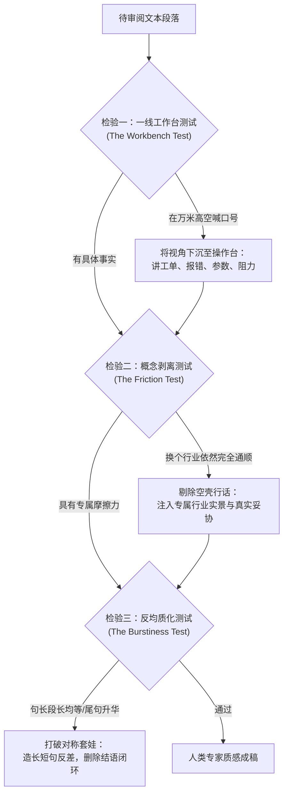

# anti-ai-narrative: 基于认知启发式的去 AI 味与叙事重塑

本 Skill 旨在解决通用大语言模型在长文写作中固有的**“过度规范、均质平滑、宏大悬浮”**等系统性 AI 特征。

与传统基于“禁用词表 / 正则黑名单”的去 AI 工具不同，本 Skill 建立在 **OpenAI 文本检测与合成文本特征论文（AI Text Detection & Classifier）** 的核心结论之上：
> **语言模型可以通过同义词轻松逃逸关键词检测，但无法自主摆脱“均质性（Uniformity）”与“低困惑度（Low Perplexity）”的底层统计惯性。必须通过认知视角切换（一线工作台）与结构破坏（高突发度、非对称），从根源打破机器生成的痕迹。**

详细理论支撑与跨领域案例见模块化文档：
- 理论底层：[openai-detection-theory.md](file:///D:/gb/Teaching-skills/anti-ai-narrative/references/openai-detection-theory.md)
- 四大领域对比案例（技术/商业/学术/治理）：[narrative-contrast-cases.md](file:///D:/gb/Teaching-skills/anti-ai-narrative/references/narrative-contrast-cases.md)

---

## 一、 交付大模型自主判断的三大认知检验法

在阅读待改写文本或生成新文本时，**严禁死记词表**，必须调动以下三个思维模型对段落进行认知审判：

### 1. 一线工作台测试（The Workbench Test）—— 视域下沉
* **问题**：AI 默认拥有“居高临下的布道者视角”，张口就是“破除壁垒、激活生态、重塑格局”。
* **判断准则**：**说话的人，手里到底有没有沾灰？**
  - 如果作者像站在聚光灯舞台或 PPT 汇报席上宣读政策口号 $\to$ **判定为 AI 腔**。
  - 如果作者像坐在工位、机房、车间或实验室，手边摊着报错日志、异常账目、推诿邮件或未达标测试集 $\to$ **合格**。
* **重塑法则**：把高空动词替换为**具体的物理动作与一线交涉**（如将“激活效力”改为“取消非必要审批盖章”、“重塑链路”改为“拆除长事务并改由消息队列削峰”）。

### 2. 概念剥离与摩擦力测试（The Friction & Transplant Test）—— 杜绝空转
* **问题**：AI 生成的“宏大叙事”本质是高度光滑的泛化废话。
* **判断准则**：**这篇段落如果隐去专有名词，直接粘贴到完全不同的行业（如从医院换到互联网、从学校换到制造厂），逻辑是否依然顺畅？**
  - 如果毫不违和，说明整段文字在**行话空转**，毫无实体信息 $\to$ **坚决重写**。
  - 真正的人类写作充满了现实的**摩擦感与妥协代价**（为了解决 A 问题不得不牺牲 B、老员工因为习惯抗拒新规定、某接口在极端情况下延迟飙升）——这些真实阻力无法被无缝移植。

### 3. 反均质化与突发度测试（The Anti-Uniformity Test）—— 打破度量衡
* **问题**：AI 存在“度量衡强迫症”，段落长度惊人一致（均在 150~200 字），且每段必然遵循微型“总—分—总”闭环。
* **判断准则**：
  - **段落节奏**：是否存在明显的段落长度落差？（必须有 30~60 字的极短事实句，与 300+ 字的紧密推导段交互并存）。
  - **段尾升华切除**：检查段落末尾是否出现黑格尔式假辩证（“这不仅……更是……”、“由此可见……”、“为……奠定了坚实基础”）。如果存在，**直接斩首删除**，让段落自然停留在具体事实或待解问题上。

---

## 二、 五步重塑执行工作流

当用户要求“去 AI 味”、“重构叙事结构”或提供文本要求降低 AI 痕迹时，按以下五步流水线作业：

### 第一步：篇章骨架解耦（破除总分总与章节克隆）
1. **废除宏观空转章**：坚决砍掉“背景意义（空谈大势）— 现状困境（泛泛而谈）— 对策建议（套话罗列）”的三段式结构。
2. **构建“问题驱动的有机推进链”**：
   - 杜绝“第一部分提了三个问题，第二部分对应三条举措，第三部分汇报三个成效”的对称镜像；
   - 采用真实的业务推进叙事：**突发/核心阻力 $\to$ 破局尝试与触壁妥协 $\to$ 流程/机制重构 $\to$ 阶段性成效与留存局限**。

### 第二步：标题去对称与去冒号（打破机器对仗）
AI 生成的层级标题有极其典型的强迫症特征，必须实施以下手术：
* ❌ **全面禁止“四字对仗 + 冒号”**（如禁止：`解耦破局：破除架构瓶颈，激活系统灵活性`）；
* ❌ **全面禁止“由……转向……”结构**；
* ❌ **全面禁止全篇各节标题字数完全相等**；
* ✅ **改为自然、平实的短语式或事实陈述式标题**（如改为：`订单域单体拆解与死锁排查`、`跨部门审批链条缩减与分工备忘录`）。

### 第三步：动词下沉与去高能化
对文中频繁出现的抽象高能动词进行“语义脱水”，强制替换为具体业务行为：
- “破除 / 破局” $\to$ 梳理出具体冲突项并叫停 / 砍掉冗余节点；
- “激活 / 赋能” $\to$ 提供即时查询接口 / 简化申领权限；
- “重塑 / 筑牢” $\to$ 固化为明确的责任排班 / 设定熔断阈值；
- “撬动 / 跃升” $\to$ 缩减处理耗时 / 提升留存比例。

### 第四步：清除假辩证、假反差与俗套隐喻
* **清缴翻案句式**：排查并删除“核心不在于……而在于……”、“绝非……而是……”、“表面看是……深层看是……”，改为客观中立的因果逻辑陈述。
* **剔除戏剧化隐喻**：严禁出现“皮鞭与拐杖”、“双刃剑”、“深水区”、“指南针”、“压舱石”等 AI 常用图腾词汇。
* **剔除无成本的全面兼顾**：删掉“既要兼顾……又要保障……”，老实交待在资源受限下的取舍选择（Trade-offs）。

### 第五步：突发度校验与事实验收
1. **句式多变度校验**：通读文本，刻意引入长短句剧烈交错（在长句解析后接一句干脆利落的短句结论）。
2. **事实保全原则**：
   > [!IMPORTANT]
   > 去 AI 绝不是删减实质内容！原稿中的核心数据、人物、时间、技术参数、实验结论、真实案例必须 **100% 完整保留**，仅剥离包裹在事实外层的空洞修辞与套话。

---

## 三、 改写自检验收矩阵（Prompting Check）

在输出改写结果前，模型应执行内心暗默核对：

| 维度 | 红色警报（存在即扣分） | 绿色通行（达标标准） |
| :--- | :--- | :--- |
| **标题风格** | 带着冒号、带并列排比动词、字数一致 | 无冒号、长短不一、纯描述性短语 |
| **段落末句** | “这不仅……更……”、“奠定了基础” | 自然结尾在数字、行动或未决问题上 |
| **叙事视重视角** | 领导动员、宏观宣导、万能替换套话 | 操作台、工位、实验室、具有专属摩擦力 |
| **矛盾表达** | 辩证兼顾、皆大欢喜、毫无痛苦 | 明确代价、遭遇过阻力、做出了取舍 |
| **节奏分布** | 段落长度整齐划一（150~200 字） | 段落长短悬殊，长短句突发度高 |

---

## 四、 跨领域触发与协同指令

当用户在不同场景下呼叫去 AI 味时，自动映射到对应的专业实践视角：
- **学术/论文场景**：切换至**“苛刻同行审稿人”**视域，强调实验边界、消融对比、计算开销与客观证据，斩断主观吹嘘（“卓越”、“突破性”）。
- **技术/架构场景**：切换至**“资深架构师/SRE”**视域，强调系统瓶颈、并发上限、死锁排查与容灾折中，斩断抽象架构空话。
- **商业/运营场景**：切换至**“一线操盘手/财务复盘”**视域，强调 ROI、获客成本妥协、客群漏斗与现金流摩擦，斩断“全域生态跃升”。
- **组织/公文场景**：切换至**“实地督查员/基层执行者”**视域，强调公文审批节点、权责边界、会签阻力与推诿问责，斩断“常态化治理格局”。
