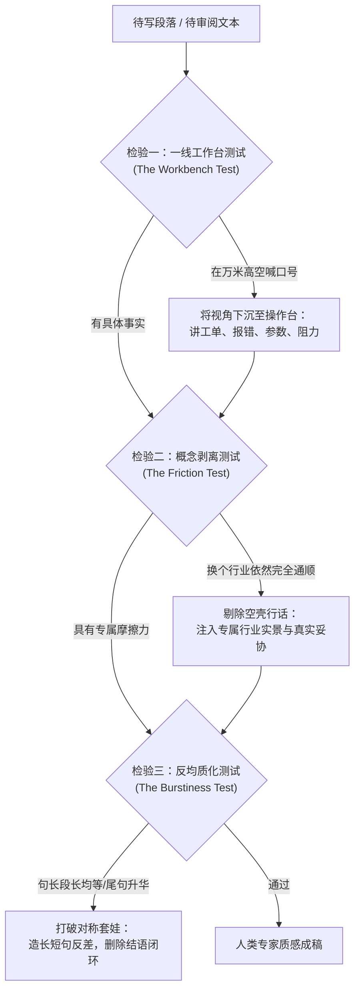

# Authentic Writing: 基于实战认知重塑的专家级写作体系

本 Skill 旨在彻底解决大语言模型在长文写作中固有的**“过度规范、均质平滑、高空悬浮”**等系统性机器特征。

整体架构确立 **`anti-ai-narrative` 的实战心法为绝对主心骨（最高优先级）**，并在第五步收尾时挂载**精简的实体保真与语体守门护栏**，形成“宏观立骨注魂，微观保真守门”的完整闭环。

底层建立在 **OpenAI 文本检测与合成文本特征论文（AI Text Detection & Classifier）** 的核心结论之上：
> **语言模型可以通过同义词轻松逃逸关键词检测，但无法自主摆脱“均质性（Uniformity）”与“平滑低困惑度（Low Perplexity）”的底层统计惯性。必须通过认知视重视角切换（一线工作台）与结构破坏（高突发度、非对称），从根源打破机器生成的痕迹。**

详细理论支撑与跨领域案例参考模块：
- 理论底层与量化度量衡：[openai-detection-theory.md](references/openai-detection-theory.md)
- 四大领域对比案例（技术/商业/学术/治理）：[narrative-contrast-cases.md](references/narrative-contrast-cases.md)

---

## 一、 交付大模型自主判断的三大认知检验法

在构思大纲、正文生成或重塑改写时，**严禁死记词表**，必须调动以下三个思维模型对段落进行认知审判：

### 1. 一线工作台测试（The Workbench Test）—— 视域下沉
* **问题**：AI 默认拥有“居高临下的布道者视角”，张口就是“破除壁垒、激活生态、重塑格局”。
* **判断准则**：**说话的人，手里到底有没有沾灰？**
  - 如果作者像站在聚光灯舞台或 PPT 汇报席上宣读政策口号 $\to$ **判定为 AI 腔**；
  - 如果作者像坐在工位、机房、车间或实验室，手边摊着报错日志、异常账目、推诿邮件或未达标测试集 $\to$ **合格**。
* **重塑法则**：把高空动词替换为**具体的物理动作与一线交涉**（如将“激活效力”改为“取消非必要审批盖章”、“重塑链路”改为“拆除长事务并改由消息队列削峰”）。

### 2. 概念剥离与摩擦力测试（The Friction & Transplant Test）—— 杜绝空转
* **问题**：AI 生成的“宏大叙事”本质是高度光滑的泛化废话。
* **判断准则**：**这篇段落如果隐去专有名词，直接粘贴到完全不同的行业（如从医院换到互联网、从学校换到制造厂），逻辑是否依然顺畅？**
  - 如果毫不违和，说明整段文字在**行话空转**，毫无实体信息 $\to$ **坚决重写**；
  - 真正的人类写作充满了现实的**摩擦感与妥协代价**（为了解决 A 问题不得不牺牲 B、老员工因为习惯抗拒新规定、某接口在极端情况下延迟飙升）——这些真实阻力无法被无缝移植。

### 3. 反均质化与突发度测试（The Anti-Uniformity Test）—— 打破度量衡
* **问题**：AI 存在“度量衡强迫症”，段落长度惊人一致（均在 150~200 字），且每段必然遵循微型“总—分—总”闭环。
* **判断准则**：
  - **段落节奏（Burstiness）**：是否存在明显的段落长度落差？段落标准差必须 $\sigma > 70$（必须有 30~60 字的极短事实句，与 300+ 字的紧密推导段交互并存）。
  - **段尾升华切除**：检查段落末尾是否出现黑格尔式假辩证（“这不仅……更是……”、“由此可见……”、“为……奠定了坚实基础”）。如果存在，**直接斩首删除**，让段落自然停留在具体事实或待解问题上。

---

## 二、 五步重塑执行工作流

不管是全流程起草新文，还是待改文本深度重塑，统一按以下五步流水线作业：

### 第一步：篇章骨架解耦（破除总分总与章节克隆）
1. **废除宏观空转章**：坚决砍掉“背景意义（空谈大势）— 现状困境（泛泛而谈）— 对策建议（套话罗列）”的三段式结构。
2. **构建“问题驱动的有机推进链”**：
   - 杜绝“第一部分提了三个问题，第二部分对应三条举措，第三部分汇报三个成效”的对称镜像；
   - 采用真实的业务推进叙事：**突发/核心阻力 $\to$ 破局尝试与触壁妥协 $\to$ 流程/机制重构 $\to$ 阶段性成效与留存局限**（重点问题占据 80% 篇幅深剖）。

### 第二步：标题去对称与去冒号（打破机器对仗）
AI 生成的层级标题有极其典型的强迫症特征，必须实施以下手术：
* ❌ **全面禁止“四字对仗 + 冒号”**（如禁止：`解耦破局：破除架构瓶颈，激活系统灵活性`）；
* ❌ **全面禁止“由……转向……”结构**；
* ❌ **全面禁止全篇各节标题字数完全相等**；
* ✅ **改为自然、平实的短语式或事实陈述式标题**（如改为：`订单域单体拆解与死锁排查`、`跨部门审批链条缩减与分工备忘录`）。

### 第三步：动词下沉与去高能化
对文中频繁出现的抽象高能动词进行“语义脱水”，强制替换为具体业务行为：
- “破除 / 破局” $\to$ 梳理出具体冲突项并叫停 / 砍掉冗余节点；
- “激活 / 赋能” $\to$ 提供即时查询接口 / 简化申领权限；
- “重塑 / 筑牢” $\to$ 固化为明确的责任排班 / 设定熔断阈值；
- “撬动 / 跃升” $\to$ 缩减处理耗时 / 提升留存比例。

### 第四步：清除假辩证、假反差与俗套隐喻
* **清缴翻案句式**：排查并删除“核心不在于……而在于……”、“绝非……而是……”、“表面看是……深层看是……”，改为客观中立的因果逻辑陈述。
* **剔除戏剧化隐喻**：严禁出现“皮鞭与拐杖”、“双刃剑”、“深水区”、“指南针”、“压舱石”等 AI 常用图腾词汇。
* **剔除无成本的全面兼顾**：删掉“既要兼顾……又要保障……”，老实交待在资源受限下的取舍选择（Trade-offs）。

### 第五步：突发度校验与终审守门（后置护栏挂载）
在此阶段调取后置护栏规范，执行终审闭环检查：
1. **突发度与长短句校验**：刻意引入长短句剧烈交错（在长句解析后接一句干脆利落的短句结论，参考 [references/openai-detection-theory.md](references/openai-detection-theory.md)）。
2. **实体与公式 100% 绝对保真**：
   - 严格对照 [references/protected-spans.md](references/protected-spans.md)，确认代码、命令行、LaTeX 公式、统计显著性数值、文献标号零篡改、零幻觉。
3. **隐蔽病灶终审清创**：
   - 对照 [references/deep-ai-patterns.md](references/deep-ai-patterns.md)，扫荡同义词强迫轮换、系词回避、信息降级（将具体数字写回概括形容词）与公文报账腔。
4. **严肃语体守门（严防口语化）**：
   - 对照 [references/style-guardrails.md](references/style-guardrails.md)，压制破折号密度（每段 $\le 1$ 处），清缴 72 个 AI 高频词，严禁出现大白话、网络热词与轻浮情绪词；
   - 若为学术论文场景，加挂 [references/academic-positive-style.md](references/academic-positive-style.md) 执行三级对照标准与合规被动语态保留。

---

## 三、 改写自检验收矩阵（Prompting Check）

在输出成稿前，模型应执行内心暗默核对：

| 维度 | 红色警报（存在即扣分） | 绿色通行（达标标准） |
| :--- | :--- | :--- |
| **标题风格** | 带着冒号、带并列排比动词、字数一致 | 无冒号、长短不一、纯描述性短语 |
| **段落末句** | “这不仅……更……”、“奠定了基础” | 自然结尾在数字、行动或未决问题上 |
| **叙事视重视角** | 领导动员、宏观宣导、万能替换套话 | 操作台、工位、实验室、具有专属摩擦力 |
| **矛盾表达** | 辩证兼顾、皆大欢喜、毫无痛苦 | 明确代价、遭遇过阻力、做出了取舍 |
| **节奏分布** | 段落长度整齐划一（150~200 字） | 段落长短悬殊（$\sigma > 70$），长短句突发度高 |
| **实体保真** | 代码被改动、公式丢失、数据被抽象概括 | 代码/公式/数据 100% 保真，具体数字完好 |
| **语体风格** | 口语大白话、网络热梗、碎句轻浮吐槽 | 严谨、扎实、专业书面质感，动词强劲直接 |

---

## 四、 跨领域触发与协同指令

当用户在不同场景下呼叫去 AI 味或撰写文稿时，自动映射到对应的专业实践视角：
- **学术/论文场景**：切换至**“苛刻同行审稿人”**视域，强调实验边界、消融对比、计算开销与客观证据，斩断主观吹嘘（“卓越”、“突破性”），严格保护合规被动语态。
- **技术/架构场景**：切换至**“资深架构师/SRE”**视域，强调系统瓶颈、并发上限、死锁排查与容灾折中，斩断抽象架构空话。
- **商业/运营场景**：切换至**“一线操盘手/财务复盘”**视域，强调 ROI、获客成本妥协、客群漏斗与现金流摩擦，斩断“全域生态跃升”。
- **组织/公文场景**：切换至**“实地督查员/基层执行者”**视域，强调公文审批节点、权责边界、会签阻力与推诿问责，斩断“常态化治理格局”。

---

## 五、 模块化参考索引（低耦合设计）

- **【实战核心】理论与范例**：
  - [references/openai-detection-theory.md](references/openai-detection-theory.md)：OpenAI 文本检测理论与长度分布关键构建（句长 5-10 vs 60+、段落标准差 σ > 70、非对称篇章 80/20 分布）
  - [references/narrative-contrast-cases.md](references/narrative-contrast-cases.md)：软件技术、商业增长、学术科研、组织治理四大领域对比案例集
- **【后置护栏】微观清创与安全守门（仅第五步调用）**：
  - [references/deep-ai-patterns.md](references/deep-ai-patterns.md)：10 种隐蔽病灶（同义词轮换/系词回避/信息降级/模糊归因/拟人化等）
  - [references/protected-spans.md](references/protected-spans.md)：受保护片段契约（代码/公式/数据/引文绝对保真与术语收束）
  - [references/style-guardrails.md](references/style-guardrails.md)：严肃专业语体红线、破折号口癖控制与高危词清单
  - [references/academic-positive-style.md](references/academic-positive-style.md)：严肃学术正向风格标准与三级对照标尺（仅学术场景加载）
